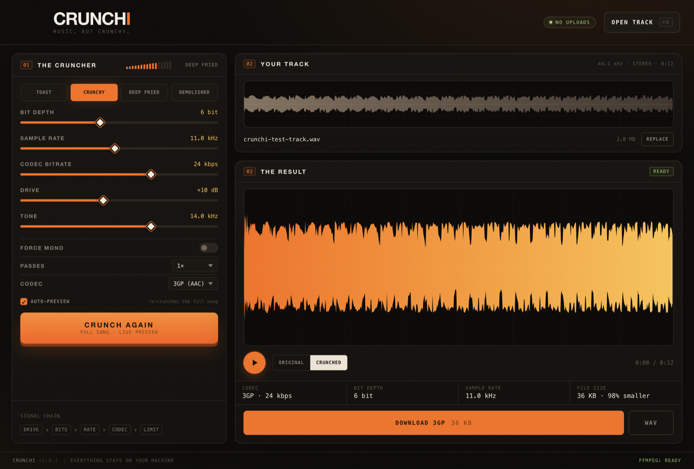
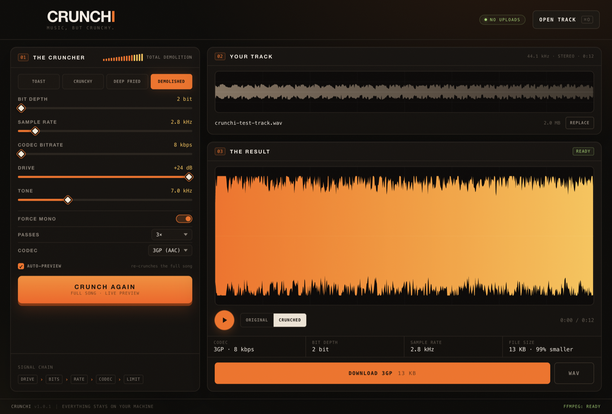

# Crunchi

**Music, but crunchy.**

Crunchi is a desktop app that takes a track and re-encodes it through a deliberately destructive signal chain: saturation, bit-depth reduction, sample-and-hold downsampling, tone shaping, and low-bitrate MP3, Opus, or 3GP/AAC codec passes. The whole song is processed — no clip previews.



## Features

- **Full-song preview.** Every setting change re-crunches the entire track in the background and keeps your playhead where it was.
- **A/B listening.** Flip between the original and the crunched version at any time.
- **Three codec engines.** Built-in MP3 encoding (lamejs, no external tools), optional Opus via ffmpeg, and 3GP/AAC for peak mid-2000s phone audio.
- **Four presets**, from lightly toasted to structurally unsound.
- **Exports.** 16-bit WAV of the preview, or the actual tiny MP3/Opus/3GP file.
- **Local-only.** No uploads, no accounts, no network calls.

## Requirements

- Node.js 20+ and npm (for development).
- macOS, Windows, or Linux. Linux packages are built as AppImage, `.deb`, and `.tar.gz`.
- Optional: [ffmpeg](https://ffmpeg.org/) for the Opus and 3GP engines. `brew install ffmpeg` on macOS, `sudo pacman -S ffmpeg` on Arch, or `sudo apt install ffmpeg` on Debian/Ubuntu. Crunchi detects it automatically and shows `FFMPEG: READY` in the footer. Opus uses ffmpeg's `libopus` encoder, so `opus-tools` is not required. 3GP uses AAC at 8 kHz mono.

MP3 works without ffmpeg because lamejs is vendored in `vendor/`.

## Run it

```sh
npm install
npm start
```

Drop an audio file anywhere on the window, or press `⌘O` / `Ctrl+O`.

## Controls

| Control | What it does |
| --- | --- |
| **Bit depth** (2–12 bit) | Quantizes sample amplitudes. Lower = grittier, more quantization noise. |
| **Sample rate** (1–22.05 kHz) | Sample-and-hold downsample. Lower = more aliasing and metallic fold-over. |
| **Codec bitrate** (8–128 kbps; 3GP: 8–32 kbps) | Bitrate for the lossy encode. Low bitrates also force the codec itself to a lower internal sample rate. |
| **Drive** (0–24 dB) | Tanh saturation into the crusher. More drive = more harmonics and compression. |
| **Tone** (2–20 kHz) | Two-pole low-pass after the crush stage. Tames the fizz or removes it entirely. |
| **Force mono** | Sums to mono before encoding. |
| **Passes** (1–3) | How many times to encode/decode through the codec. More passes = more generation loss. |
| **Codec** | MP3 (built in), Opus (ffmpeg), or 3GP/AAC (ffmpeg, 8 kHz mono). |

**Auto-preview** is on by default: drag a slider and the whole song re-renders after a short debounce. The playhead and A/B selection are preserved. Turn it off for manual `CRUNCH AGAIN` renders.

`Space` toggles playback. `⌘S` / `Ctrl+S` saves the lossy file when a result is ready.

## Presets

| Preset | Bits | Sample rate | Bitrate | Drive | Tone | Passes | Mono |
| --- | ---: | ---: | ---: | ---: | ---: | ---: | :---: |
| Toast | 10 | 22.05 kHz | 64 kbps | 4 dB | 18 kHz | 1 | – |
| Crunchy | 6 | 11.0 kHz | 24 kbps | 10 dB | 14 kHz | 1 | – |
| Deep Fried | 4 | 5.5 kHz | 12 kbps | 16 dB | 10 kHz | 2 | ✓ |
| Demolished | 2 | 2.8 kHz | 8 kbps | 24 dB | 7 kHz | 3 | ✓ |

## 3GP mode

3GP is the mid-2000s time machine: AAC in a 3GP container, forced to 8 kHz mono and capped at 32 kbps. Standard ffmpeg builds do not include an AMR encoder, so Crunchi uses AAC — a standard 3GP music codec (AMR was typically used for voice). For maximum flip-phone energy, choose **Demolished**, set the codec to **3GP (AAC)**, and drop the bitrate to **8 kbps**.



## Signal chain

```
fade edges → tanh drive → bitcrush → sample-and-hold downsample
→ 2-pole low-pass → DC removal → normalize
→ codec pass(es) → final fade → normalize
```

For Opus and 3GP, the renderer sends 16-bit PCM to the Electron main process, which writes a temporary WAV, runs `ffmpeg`, decodes the result back to PCM for the preview, and returns both the encoded bytes and the decoded audio. Opus uses `libopus` (CBR, 60 ms frames); 3GP uses AAC at 8 kHz mono and 8–32 kbps. Temp files are removed afterwards.

## Exports

- **WAV** — 16-bit PCM of exactly what you hear in the preview (44.1 kHz).
- **MP3 / OPUS / 3GP** — the actual lossy file produced by the last render. This is the small one.

Files are saved as `<track name> (crunchy).<ext>`.

## Build a desktop app

```sh
npm run pack   # unpacked app directory in dist/
npm run dist   # packages for the current platform
```

macOS builds produce a DMG and zip. The macOS bundle is unsigned by default. For distribution, sign and notarize it with your Apple credentials.

### Linux

On Arch, install the build and runtime prerequisites:

```sh
sudo pacman -S --needed base-devel nodejs npm git fakeroot
sudo pacman -S --needed gtk3 nss libxss libxtst libcups alsa-lib \
  at-spi2-core libdrm mesa libxkbcommon libxcomposite libxdamage \
  libxrandr
```

Most of the Electron runtime libraries are already present on a normal desktop Arch install, and `mesa` supplies `libgbm`. You do not need `dpkg`: electron-builder bundles its own `.deb` packaging tool. Install `dpkg` only if you want to inspect the result with `dpkg-deb`.

Then build all Linux packages:

```sh
npm install
npm run dist:linux
```

This writes three artifacts to `dist/`:

- `Crunchi-<version>-x86_64.AppImage` — portable single file
- `Crunchi-<version>-amd64.deb` — Debian/Ubuntu package
- `Crunchi-<version>-x64.tar.gz` — plain unpacked bundle

To run the AppImage on Arch, install FUSE 2 (`sudo pacman -S --needed fuse2`) or use `./Crunchi-*.AppImage --appimage-extract-and-run`.

The [Linux release workflow](.github/workflows/release-linux.yml) builds these packages on Ubuntu and attaches them to the matching `v*` GitHub release. It can also be run manually from the Actions tab.

## Project layout

```
main.js          Electron main process, dialogs, save, ffmpeg Opus/3GP IPC
preload.js       contextBridge API exposed to the renderer
index.html       UI markup
styles.css       visual design
js/dsp.js        crunch engine, presets, MP3 encode/decode
js/wav.js        16-bit WAV encoder
js/app.js        UI state, auto-preview, playback, A/B, downloads
vendor/          vendored lamejs MP3 encoder + license
build/icon.png   app icon
docs/            screenshot
```

## Notes

- Tracks longer than 30 minutes are rejected to keep memory use bounded.
- Renders are CPU-bound and run in the renderer with periodic yields, so the UI stays responsive.
- The preview is the decoded lossy file, not a simulation: what you hear is what the export contains.
- 3GP is always mono at 8 kHz; the preview is upsampled back to 44.1 kHz so it lines up with the original. You can also drop a `.3gp` file in to re-crunch it.
- MP3 encoding uses lamejs (LGPL-3.0). See `vendor/lamejs-LICENSE.txt` and `vendor/LGPL-3.0.txt`.
- ffmpeg is optional and used only for the Opus and 3GP engines.

## License

Crunchi is released under the MIT License. The vendored lamejs encoder remains under the LGPL-3.0.
